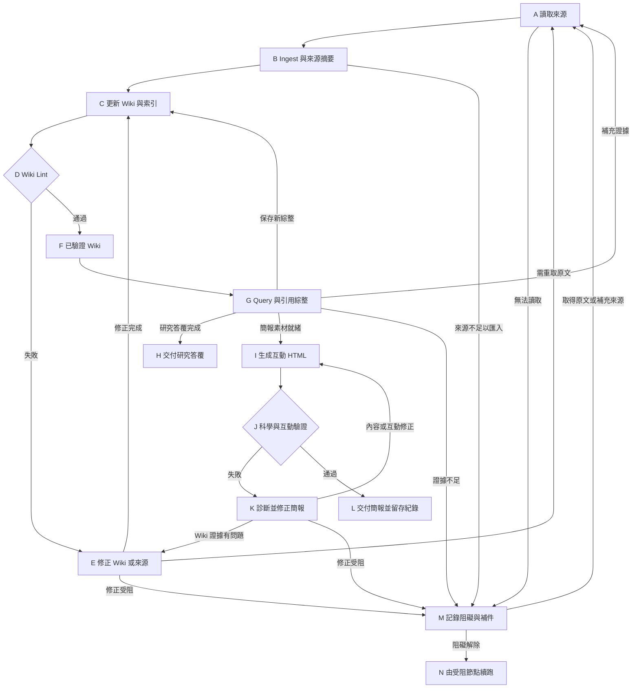

# Wiki 與教學簡報工作流程

此圖是流程設計。執行時將實際節點、結果及修正寫入 [log.md](../log.md)，並依[報告範本](../templates/check-report.md)保存每次檢查，包括初檢及複檢。

| 節點 | 輸入 | 輸出 | 通過條件 | 失敗處理 |
| --- | --- | --- | --- | --- |
| A | 原檔或網址 | 已讀原文及可讀範圍 | 確定來源身分與版本，可定位所需內容 | 記錄缺件及可讀範圍，轉 M |
| B | 已讀內容、來源資料範本 | 原件或存取資訊、來源摘要 | ID 唯一，已核對欄位，發現可回查 | 欄位錯誤留在 B 修正；證據不足轉 M |
| C | 摘要或綜整、既有 Wiki | 更新的概念頁、索引、交叉連結及 log | 受影響主張已逐項處理，變更已登記 | 留在 C 補齊，證據有問題轉 E |
| D | Wiki、原文、檢查範圍 | L1–L7 結果與報告 | 規則逐項執行，無阻擋項 | 轉 E 或記錄受阻 |
| E | 失敗報告與受影響頁面 | 修正內容及複檢清單 | 各問題皆有修正或明確待辦，阻擋項須複檢 | 需重取證據轉 A，受阻轉 M |
| F | Lint 通過報告、對應 Wiki 版本 | 供查詢的已檢查知識 | 報告範圍涵蓋取用頁面及其證據 | 回 D 擴大檢查 |
| G | 問題或簡報目標、索引與證據 | 附引用綜整、待查問題或簡報素材 | 核對樣本、分母、計數單位、原文位置與適用範圍；簡報另須至少五份可靠來源及全庫 Lint 通過 | 缺證據轉 A 或 M，仍可交付有界線的研究答覆 |
| H | 附引用的綜整 | 研究答覆 | 結論或待查原因可追溯 | 回 G 補齊 |
| I | 已檢查的問答、證據定位 | `slides/` 的互動 HTML 草稿 | 每題有猜測、答案、科學解釋及可回查引用 | 在 I 修正生成問題，證據需補正轉 G |
| J | 草稿、Wiki 及原文 | 逐題與互動驗證報告 | 核對題幹、選項回饋、數字、圖表、圖像署名與引用；實際測試選擇、揭曉、返回及鍵盤操作；無阻擋項 | 轉 K，保存失敗步驟與觀察結果 |
| K | 簡報驗證報告 | 修正草稿或 Wiki 修正清單 | 問題可重驗，受影響的題目與操作已列出 | 證據問題轉 E，受阻轉 M |
| L | 通過驗證的 HTML 與報告 | 簡報及可回溯的執行紀錄 | 交付版本與檢查版本一致，log 串起初檢、修正及複檢 | 版本有差異回 J，缺紀錄時補齊 |
| M | 缺件、未取得的證據或其他阻礙 | 待查項、影響範圍與恢復條件 | 阻礙及重啟條件可追溯 | 保持受阻，保留已完成工作 |
| N | 障礙解除的證據、先前報告 | 從記錄中的節點續跑 | 確認依賴已取得，標記實際續跑時間 | 回 M 更新阻礙 |

複檢使用實際修正後的版本。簡報若因 Wiki 證據有問題而回到 E，須重新通過 D，經 G 更新受影響的引用與素材，再經 I、J 產出及檢查新版本。即使初檢就通過，也應照實登錄結果；修正迴圈僅在實際發生時留下執行紀錄。

## 本次作業的實際執行

- Wiki 的修正迴圈走了 D → E → C → D。初檢發現休息洞的敘述容易把七隻的合計讀成每個洞都由多隻共用。修正後複檢通過。[初檢](../reports/lint-corpus-initial.md) · [複檢](../reports/lint-corpus-recheck.md)
- 後續生成簡報時，在既有的 G 先核對樣本、分母、計數單位與適用範圍。I 生成後，J 再核對成品與互動。讀者回饋促成多輪內容與版面修訂，各版的實測範圍見[簡報驗證](../reports/slides-validation.md)。
- Codex 依流程執行判斷與修改，程式輔助靜態檢查。公開版於 L 交付。
